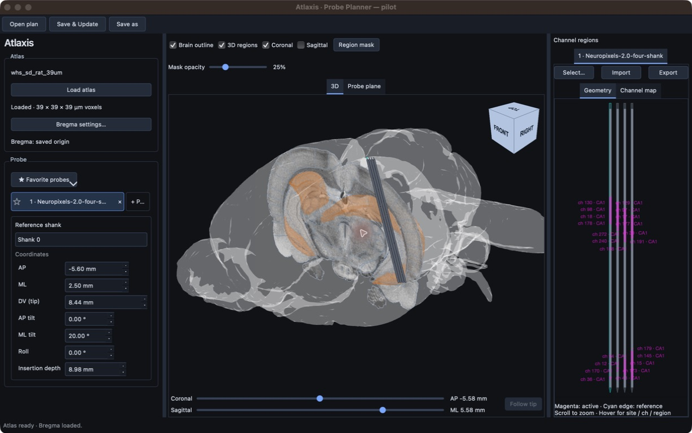
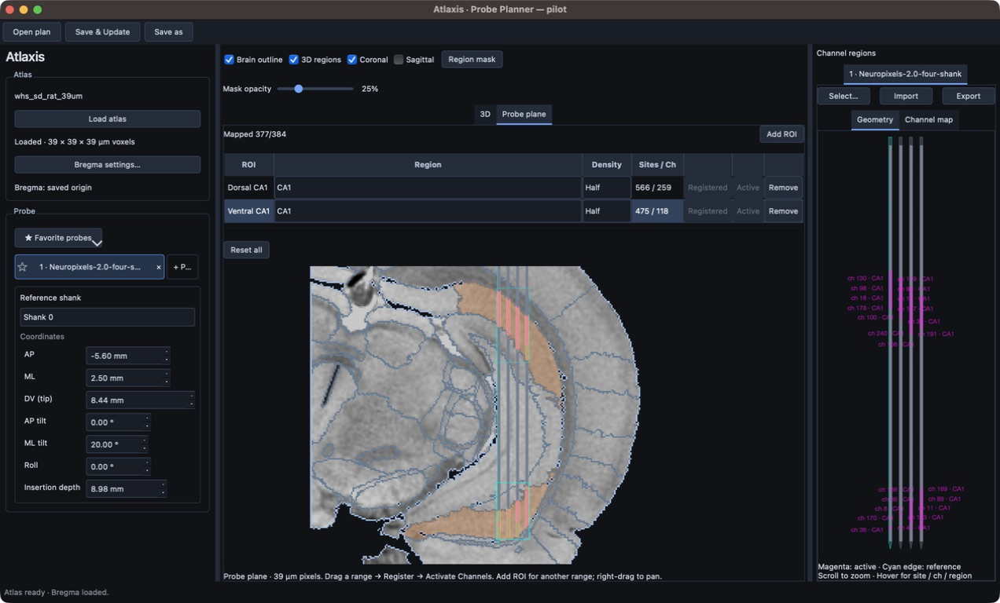

# Atlaxis

Plan electrophysiology probe placement and Neuropixels recording channels in a 3D brain atlas.

- **[BrainGlobe](https://github.com/brainglobe/brainglobe-atlasapi)** provides the atlas backend.
- **[NeuroCarto](https://neurocarto.readthedocs.io/en/latest/)** provides the Neuropixels channel-selection backend.

## Install

Download your platform's installer from
[Releases](https://github.com/yoshihito-saito/Atlaxis/releases/latest). No Python setup is required.

| Platform | Installation |
| --- | --- |
| macOS Apple Silicon | Open `Atlaxis-macOS-arm64.dmg`, drag **Atlaxis.app** onto **Applications**, eject the disk image, and open the app from Applications. |
| Windows x64 | Run `Atlaxis-Windows-x64-Setup.exe`, follow the installer, and launch **Atlaxis** from the Start menu. |

Builds are currently unsigned. On macOS, if Apple cannot verify the app, confirm
the download source and use **System Settings → Privacy & Security → Open Anyway**.
The installer format does not remove OS security checks.

On first launch, choose a data folder (default: `Documents/Atlaxis`).
A local `README.md` quick-start guide is saved there; an existing README is kept.
Atlases download on first use. Developers: [install from source](docs/development.md).

To update, quit Atlaxis and replace the Mac app or run the new Windows installer.
To uninstall, remove the Mac app or use Windows **Settings → Apps**. Your chosen
data folder and saved settings are retained.

## Workflow

1. **Load atlas** and verify the Bregma origin.
2. **+ Probe** — choose a probe, check its wiring, and set position, tilt and depth.
3. Select Neuropixels channels as below, then **Save & Update** to save the plan.

**Save & Update** writes `<plan-folder>.xml`, `channelmap.mat` and
`anatomical_map.csv` in the plan folder. These combine all probes in plan order.
Open `atlaxis/plan.json` to edit the saved plan; descriptions, coordinate lists,
manifests and selection/display companions are also kept under `atlaxis/`.
Use **Save As Different Plan** (Ctrl+Shift+S) to save the current state in a new
plan folder. Subsequent **Save & Update** applies to that new plan.

The channelmap uses PreprocessPipeline's `chanMap`/`chanMap0ind`, `connected`,
`xcoords`/`ycoords`, `kcoords` and `probe_ids` fields. Coordinates are in µm.
Each probe keeps its native channel distances without scaling. Consecutive
probe-tip AP/ML distances are unfolded along x, with tip DV offsets along y;
distances between probes are approximate. Double-sided/nonplanar probes also write
standard `zcoords`, relative to each probe's minimum native z, so PreprocessPipeline
can retain within-probe XYZ distances for local reference and postprocess sparsity.
`physical_xyz_um` separately retains the real 3D positions (AP, right-positive ML, DV).
Sorting that only uses x/y still omits face separation; writing z does not make a
2D sorter use 3D distances. Phy's display projection is separate from analysis.
Unknown wiring prevents MAT output and shows a warning;
the plan remains saveable. The anatomical CSV has no header: columns follow XML
groups, and rows follow the channels within each group. Unknown labels are blank.

Saving an older bundle moves only its manifest-owned support files into `atlaxis/`.
Earlier manual exports remain independent snapshots.

Choose a supported rat or mouse atlas from **Load atlas**. Bregma is set automatically.

### Skull and craniotomy

Supported mouse/rat atlases automatically prepare a CT reference skull, hidden by
default. Enable **Skull (CT ref.)** to show it; use **Settings → Skull…** to adjust
placement. Models download on first use and are cached locally.

1. Open **Make craniotomy** for a top view with Bregma/Lambda.
2. Use **+** / **×** to add or remove openings. Choose Rectangle, Circle or Polygon;
   enter the AP/ML center and rectangle size or circle diameter in mm. ML is left-positive.
3. Left-drag draws rectangles/circles; click polygon vertices and press Enter to
   finish. Right-drag moves an opening, middle-drag pans, the wheel zooms, and
   double-click resets the view.
4. **Apply craniotomy** updates the 3D view and closes the editor.
   **Save & Update** saves the skull and editable openings with the plan.

CT skulls have approximate alignment and size; they do not establish individual
anatomical fit or validated bone thickness. Check [source terms](THIRD_PARTY_NOTICES.md)
before sharing plans containing downloaded meshes. To update an older plan's
atlas correction, use **Settings → Use atlas alignment preset**, then **Save & Update**.

### Microdrives

Select a chronic probe, open **Microdrive…**, and choose Cambridge NeuroTech
**nano-Drive**, **pico-Drive**, **3Dneuro Metal drive** or **Metal drive NP**.
**Attach to probe** applies the attachment and closes the dialog.

- **Mount offset** sets the probe's vertical position on the carriage. At zero,
  their lower-left corners align when viewed from the probe side; positive values
  move the probe up. **Align base** aligns an existing mount to this reference.
- **Drive travel** in the left **Probe** panel moves the carriage and attached
  probe together, updating insertion depth and tip DV. The fixed body stays in place.
- **Dimensions…** adjusts the simplified model to your hardware. Some probe-base
  dimensions are estimates; Metal drive NP provisionally represents R2drive L.
  See [dimension notes](plan_and_log/2026-09-26-skull-drive-planning.md).

## Probes

| Library | Layouts |
| --- | --- |
| Neuropixels | 1.0; 2.0 single- and four-shank |
| Cambridge NeuroTech | 171 models |
| NeuroNexus | Buzsaki, linear and Poly |
| Custom | JSON or CellExplorer MAT |

[Full probe library and wiring details](probes/README.md)

> **Always verify the channel map yourself before recording**, against your actual
> probe, headstage, adapter and acquisition setup.

## Neuropixels channel selection

1. Click **Select…**, draw an ROI, choose **Region** and **Density**, then **Register**.
2. **Activate Channels** uses NeuroCarto to select sites within the ROI. Activate
   priority ROIs first; **Add ROI** adds another range while keeping existing assignments.
3. In the right-hand **Geometry**, double-click a Neuropixels site to turn it
   ON/OFF. Labels identify physical **Site IDs**. Active sites are magenta;
   inactive sites that can be activated are green; blocked sites are gray.
   Turning a site OFF makes alternatives sharing its channel available.
   Double-click the background to fit the view. The **Channel map** also offers
   **ON** checkboxes and Site IDs, without a Hardware channel column.
   The default view has one row per hardware channel in the current acquisition
   routing, including its OFF sites. **Show alternative sites** displays other
   physical electrodes; green **Available** sites can be added with the current ON sites.
   **Blocked** sites share a channel with an ON site; turn that site OFF first.
   In this candidate view, clear **Active / available only** to show blocked sites.
   Switching to another site on the same hardware channel retains that channel ID.
4. **Export → IMRO + selection**, then load the `.imro` in
   [Open Ephys](https://open-ephys.github.io/gui-docs/User-Manual/Plugins/Neuropixels-PXI.html#imro-files)
   or [SpikeGLX](https://billkarsh.github.io/SpikeGLX/help/imroTables/).

IMRO fills all 384 channels, including additional sites outside your ROIs when needed.
The support CSV `atlaxis/<IMRO-name>.active_channels.csv` marks targets with
`is_target=1`; `atlaxis/<IMRO-name>.selection.json` restores your ROI selection.
The matching `<IMRO-name>.xml` uses the same routing and marks non-target channels
with `skip=1`. IMRO exports also write `<IMRO-name>.channelmap.mat` and
`<IMRO-name>.anatomical_map.csv` for that probe; explanations go under `atlaxis/`.
XML outputs are channel-group templates; add actual recording metadata.

Licensed under [GNU GPL v3.0](LICENSE.md). See [third-party notices](THIRD_PARTY_NOTICES.md).
